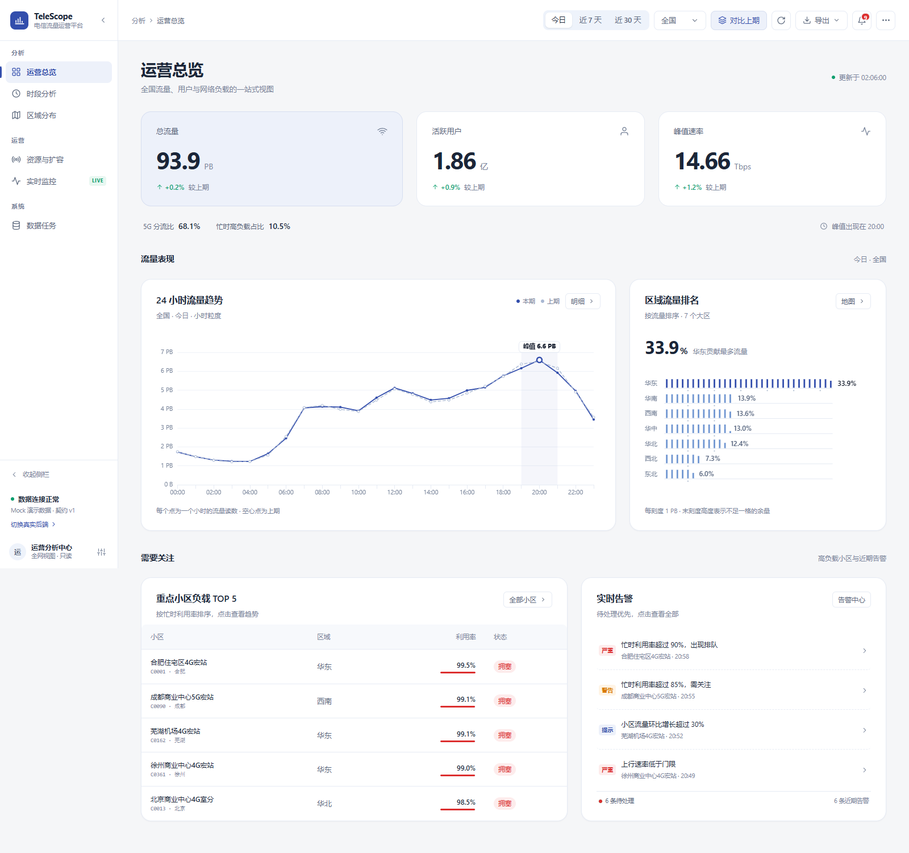

# TeleScope · 电信流量运营分析平台

《分布式系统原理与实践》大作业 · 题目 9「电信运营商用户流量分析」的**纯前端**部分。

一个可直接演示的 BI 看板：总览、时段、区域、资源、实时、数据任务六个页面，覆盖 Quick BI 原题要求的「流量高峰时段 / 地区分布 / 网络资源优化」，并补充课程要求的实时流与消费组负载均衡展示。

接手改代码先读 [docs/接手说明.md](docs/接手说明.md)，里面写了目录、数据流、图表层的坑和新增页面的步骤。



## 快速开始

环境：Node 20+、pnpm 11（本项目在 Node 24 / pnpm 11.28 下验证；`esbuild` 的构建脚本已在 `web/pnpm-workspace.yaml` 里放行）。

**Windows 最省事**：直接双击项目根目录的 `启动演示.bat`，它会检查依赖、启动服务并打开浏览器。

```bash
cd web
pnpm install
pnpm dev        # http://127.0.0.1:5178
pnpm build      # 产物在 web/dist
pnpm preview    # 预览构建产物，http://127.0.0.1:5179
```

> `web/index.html` 是 Vite 的入口模板，**不能双击直接打开**：它引用 `/src/main.ts`，需要 Vite 编译 Vue/TS；`file://` 下模块脚本和 `fetch` 也会被浏览器拦截。`web/dist/index.html` 同理，要用 `pnpm preview` 或静态服务器打开。

### 部署

- **GitHub Pages**：把仓库推到 GitHub 后，`.github/workflows/deploy.yml` 会自动构建 `web/dist` 并发布；仓库 Settings → Pages → Source 选 **GitHub Actions** 即可。
- **任意静态服务器**：`pnpm build` 后把 `web/dist` 整个目录上传；使用 hash 路由，不需要配 rewrite。

## 目录

```
大作业-电信流量分析平台/
├─ data/gen_data.py           # 固定种子生成 30 天模拟数据
├─ web/
│  ├─ public/data/dataset.json # 聚合后的演示数据（约 214 KB）
│  ├─ public/geo/china.json    # 中国地图 GeoJSON（本地化）
│  ├─ src/api/                 # 类型、Mock、HTTP 客户端
│  ├─ src/components/          # 外壳、图表、KPI、抽屉、命令面板
│  ├─ src/views/               # 六个页面
│  ├─ src/stores/ui.ts         # 全局筛选、阈值、Toast、下载
│  └─ tools/                   # 截图与交互回归脚本
├─ docs/
│  ├─ 接手说明.md               # 给下一位开发者的架构与踩坑说明
│  ├─ 接口契约-v1.md           # 后端照此实现即可联调
│  ├─ 答辩演示.md              # 5 分钟演示路径与问答
│  └─ shot-*.png               # 六页截图
├─ THIRD_PARTY.md              # 依赖许可与地图/数据来源
└─ README.md
```

## 六个页面与可操作控件

区域地图现已升级为 3D：点击城市可运镜聚焦行政区，并联动城市负载、4G/5G 结构与重点小区排名。覆盖 60 个城市，支持搜索、连续切换和一键返回全国。数据口径及操作说明见 [3D 地图说明](docs/3D地图说明.md)。

| 页面 | 内容 | 可操作 |
| --- | --- | --- |
| 运营总览 | 3 个核心 KPI、2 项辅助指标、24h 趋势、区域排名、TOP5 小区、实时告警 | 时间范围、区域、同比对比、刷新、导出 CSV、点小区开详情、点告警开弹窗 |
| 时段分析 | 周×小时圆点热力图为主体，选日期后展开当天指标、24h 分布、时段构成与明细 | 左侧日期选择、点击圆点、绝对值/占当天、柱状/折线、前一天对比、可选日均线、展开明细 |
| 区域分布 | 中国地图、31 省明细、大区结构、省份下钻 | 流量/用户/人均/增速切换、地图缩放、点省下钻、表头排序、搜索、大区筛选 |
| 资源与扩容 | 连续分箱直方图、4G/5G 分组点图、用户×利用率散点、420 小区分页表 | 制式分布/用户规模切换、状态卡筛选、搜索、排序、分页、点行开详情、生成扩容建议→下发工单 |
| 实时监控（深色） | 实时速率、消息流、消费组分区、告警 | 暂停/继续、1×/2×、清空、沉浸全屏、模拟消费者缩容/恢复 |
| 数据任务 | 作业列表、数据源、数据链路 DAG、折叠的接口契约与指标口径 | 刷新、重跑失败作业、作业详情、复制路径、导出、展开技术说明 |

全局还提供：`Ctrl/Cmd + K` 命令面板、`?` 快捷键、全屏演示、打印/存 PDF、告警确认、阈值设置（预警/拥塞）、自动刷新。

## 数据说明

- 生成脚本：`data/gen_data.py`，种子 `20261108`，重复运行结果一致。
- 范围：2026-10-10 至 2026-11-08，31 个省级行政区、7 个大区、420 个重点小区。
- 量级：今日 93.9 PB、峰值 14.66 Tbps（20:00）、活跃用户 1.86 亿。
- 数据为**模拟构造**，不含任何真实用户信息；字段口径见 `docs/接口契约-v1.md`。

重新生成：

```bash
python data/gen_data.py
```

## 接别人写的后端

前端所有数据都走 `src/api/client.ts`，页面不直接碰接口。

```bash
# web/.env.local
VITE_DATA_MODE=api
VITE_API_BASE=http://192.168.10.101:8080
```

- 开发环境 `/api` 自动代理到 `VITE_API_BASE`，后端无需 CORS。
- 生产环境用 Nginx 同域反代 `/api`，或后端允许跨域。
- 接口、字段、单位、错误码、SSE 预留格式：见 [接口契约-v1.md](docs/接口契约-v1.md)。
- 后端字段与契约不一致时，只改 `src/api/client.ts` 的适配层，页面不用动。

## 与 Quick BI 的双轨关系

组里用真实 Quick BI 交「BI 工具」这一环；本前端作为自研看板做交互与答辩演示，两者字段口径对齐。

| 自研页面 | Quick BI 对应图表 |
| --- | --- |
| 运营总览 | 指标看板 + 折线图 + 横向排名图 |
| 时段分析 | 折线图 + 交叉表热力图 |
| 区域分布 | 色彩地图 + 排行榜 |
| 资源与扩容 | 明细表 + 散点图 + 条件格式 |
| 实时监控 | 实时数据源图表（Quick BI 实时看板） |

报告里建议写：数据经 HDFS/MapReduce/Spark 聚合入 HBase，Quick BI 与自研前端读取同一份聚合结果；前端负责交互下钻与实时演示。

## 验证记录

- `pnpm build`：703 个模块，构建成功（2026-11-09）。
- 浏览器控制台：6 个页面 0 error。
- 交互回归（在 `web/` 下执行 `node tools/e2e.mjs`）：17/17 通过（筛选联动、告警确认、Toast 居中、命令面板、扩容工单、缩容、作业重跑、阈值保存）。
- 问题修复回归（`node tools/fix-verify.mjs`）：覆盖日期详情、柱状/折线/日均线/对比、热力图百分比、地图指标、tooltip、角标、指标卡稳定性、侧栏精简。
- 布局回归（`node tools/layout-verify.mjs`）：1280 / 768 / 390 宽度下的六页布局、图表初始化和技术说明键盘展开/收起。
- 模板与数据回归（`node tools/template-verify.mjs`）：日期选择与当天读数、100 点构成、168 个热力读数、分箱总数、全部小区散点、详情仪表与消息份额。模板选型见 [图表模板选型](docs/图表模板选型.md)。
- 截图脚本（`node tools/shot.mjs`）输出 `docs/shot-*.png`。

### 2026-11-09 修复

- 图表不随筛选/开关刷新：`BaseChart` 补回 `option` 监听；ECharts 实例改用 `shallowRef`（深度响应式代理会破坏坐标系统，导致 tooltip 不显示、resize 报错）。
- 对比按钮：只保留在总览/时段两页，文案改为「对比上期」，切换时真正增删曲线。
- 热力图：切「占全天」时 series + visualMap 一起替换，单日合计 100%。
- 地图：切换流量/用户/人均/增速时替换 series + visualMap，颜色和数值同步。
- 告警角标：改为全局 store，确认/刷新/60 秒轮询都会更新。
- 侧栏：移除折叠入口、底部连接状态与账户区，仅保留品牌与导航；窄屏图标模式仍保留悬停模块名提示。

## 已知边界

- 实时页在 Mock 模式下由前端定时器模拟；SSE 接口已写入契约，接后端后替换 `Realtime.vue` 的定时器即可。
- 告警「确认」、作业「重跑」当前是前端本地反馈，未持久化。
- 未做登录与权限；如需 Token，在 `client.ts` 统一加请求头。
- 地图底图为阿里 DataV 中国 GeoJSON，已本地化，不依赖外网。
- 封面学号、姓名、班级留空，由本人填写。
